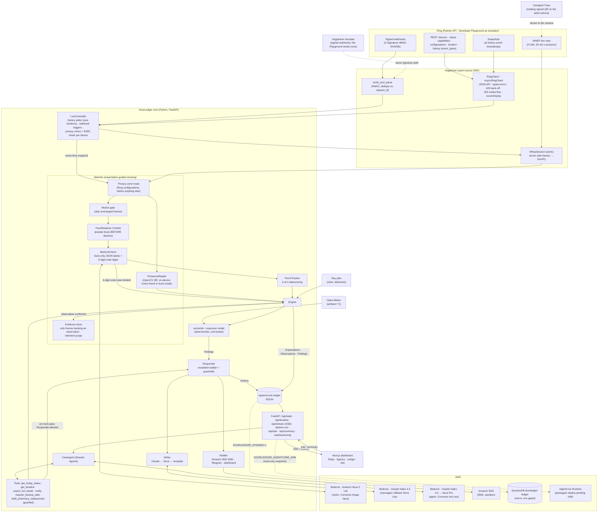
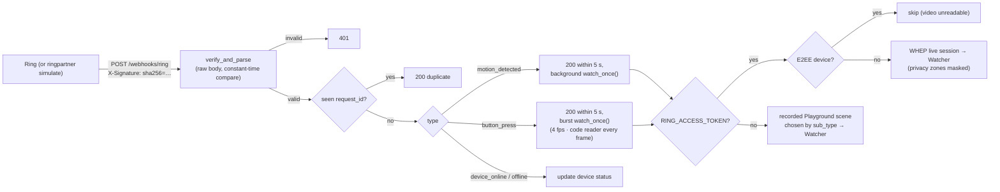
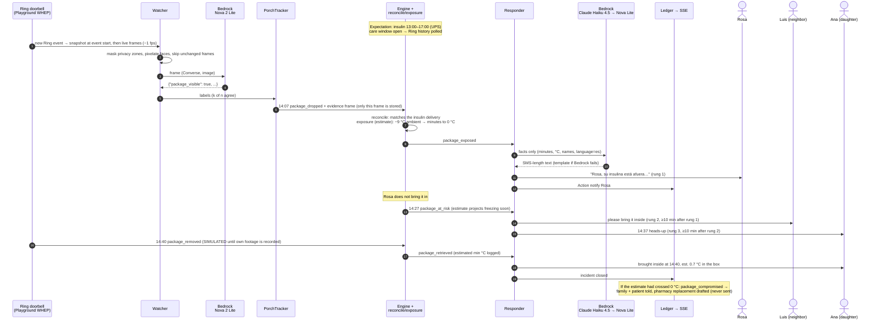
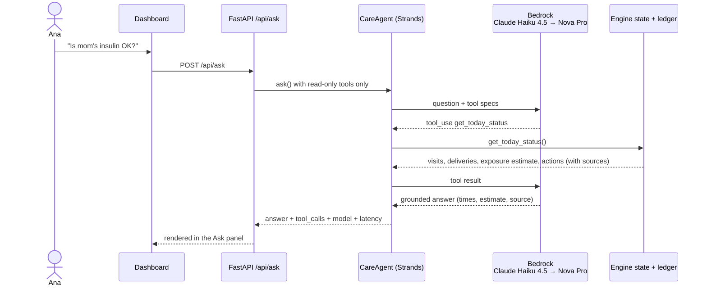

# DoorLedger architecture

DoorLedger compares the care that was **expected** at an older adult's front door with what the
Ring doorbell **observed**, and acts only on the difference. Expected care means caregiver visits
and temperature-sensitive medication deliveries. The design follows one rule. **Ground truth is
deterministic, and LLMs work at the edges**: they perceive frames, phrase messages and answer
questions. They never decide whether a visit happened or whether a package is safe.

See also: [`aws_architecture.md`](aws_architecture.md) for AWS services and the AgentCore
deployment plan, [`agent_spike.md`](agent_spike.md) for the CareAgent evaluation, and
[`BUSINESS.md`](BUSINESS.md) for what the sensing design costs per household.

## Component diagram



### Data model (`core/src/doorledger/domain.py`)

| Type | Produced by | Examples |
|---|---|---|
| `Expectation` | the day plan (agency schedule, pharmacy shipment) | "Morning personal care 09:00–11:00, Maria, 120 min"; "Insulin refill 13:00–17:00, UPS" |
| `Observation` | Watcher (Ring frames) or scenario steps | `package_dropped`, `package_removed`, `vehicle_arrived`, `presence_check_in/out`, each with a `Source` (`ring_live_view`, `ring_snapshot`, `ring_webhook`, `own_footage`, `simulated`) and an evidence frame |
| `Finding` | `reconcile()` (pure function) | `late_arrival`, `missed_visit`, `short_visit`, `package_exposed`, `package_at_risk`, `package_compromised`, `package_retrieved` |
| `Action` | Responder or guarded agent tools | `notify`, `request_backup`, `pharmacy_claim` (draft only) |

Everything is appended to the ledger. The dashboard timeline, the EVV CSV (the six 21st
Century Cures Act fields plus verification method and evidence) and the CareAgent all read from
that one source.

### Key design decisions

1. **Expectation-guided sensing.** The Watcher does not watch the door all day. It looks only
   while care is expected (±30 min around a window) or when Ring reports an event. With a live
   token, `LiveController` polls Ring history every 15 s during care windows. For each new
   event it classifies the snapshot taken at the event's start (source `ring_snapshot`), then
   opens a short live view (25 s at 1 fps). A doorbell press (`ding` in history, or a
   `button_press` webhook) switches to **burst mode**: 4 fps for about 12 s, with the code
   reader on every frame. Without a token, the same code runs on recorded Playground frames. A
   motion gate reuses the last label for unchanged frames, which cut vision calls by 38–60% in
   our replay runs (see [BUSINESS.md](BUSINESS.md) for what this means per household).
2. **Presence without biometrics.** Each visit gets a 32-byte secret. The Caregiver Pass (a
   static page; the secret travels in the URL fragment) shows a QR code that rotates every 15
   s. The code is an HMAC over the visit, the time step and the role, so a check-in code can
   never count as a check-out. The backend verifies the MAC and the time step, and rejects
   replays. The fallback is the pass's 6-digit code, read by the vision model
   (`phone_code_digits`) and verified with `presence.verify_numeric_code`, rate-limited to 10
   attempts an hour per door. What this establishes is a **verifiable check-in signal**: a
   device showing the visit's current signed code was at the door. It does not identify who
   held the phone. No faces are recognised.
3. **Privacy before perception.** On every frame, the device's Ring privacy zones
   (`configurations.image_enhancements.privacy_zones`) are blacked out first. Faces are then
   pixelated (YuNet) **before** the frame is sent to Bedrock. Only a frame that backs a
   confirmed observation is written to disk, and stored frames older than
   `DOORLEDGER_RETENTION_DAYS` are purged at API startup. Devices with end-to-end encryption
   are skipped (`live._prepare_device`).
4. **Debounce before you alert.** Vision labels flicker. `PorchTracker` emits a transition
   only when k of the last n frames agree.
5. **Deterministic reconciliation.** `reconcile.py` sets the rules: late after a 15 min grace,
   missed after 45 min, short visit, delivery overdue. `exposure.py` models the package as a
   lumped body moving toward ambient temperature, using Newton's law with a sun or shade time
   constant. It estimates the temperature inside the box and the time left until the heat
   limit (30 °C) or freezing (0 °C) for insulin. The estimates are labelled as estimates.
6. **Guardrailed actions.** The Responder climbs a ladder: patient → neighbor → family, with a
   gap of at least 10 min between rungs (enforced both when a new `package_at_risk` finding
   arrives and in the periodic follow-up) and at most 5 messages per incident. Visit problems go
   to the agency and the family, and a caregiver is never contacted directly. The CareAgent's
   act tools go through the same `Responder.allowed` checks plus extra rules (open incident
   only, no repeats within 10 min). A refusal goes back to the model as a tool result.
7. **Graceful degradation.** Writer: Claude Haiku 4.5 → Nova Lite → template, so an alert is
   never blocked by an LLM. Agent: Claude Haiku 4.5 → Nova Pro. A model the account cannot use
   is skipped for the rest of the process.
8. **Same code, live or recorded.** `RingLiveSource` (WHEP) and `ReplaySource` (recorded Ring
   Playground frames) produce the same `Frame` stream. With `DOORLEDGER_PERCEPTION=cache`
   (`make api-offline`), `CachingVision` answers with the labels Bedrock produced for those exact
   frames (`fixtures/ring_playground/vision_cache.json`). The offline demo therefore runs the
   real pipeline on real Ring footage with no AWS credentials. A cache miss returns an empty
   scene, never an invented detection.

### Webhook path



## Sequence: medication on a freezing porch

Demo household: Rosa Martínez, 81, Chicago, −9 °C. Insulin refill expected 13:00–17:00. Times
match the `porch_cold` scenario and the tests in `core/tests/`.



Later, Ana opens the dashboard and asks: *"Is mom's insulin OK?"*



## Sequence: caregiver check-in (rotating signed presence code)

```mermaid
sequenceDiagram
    autonumber
    participant Ag as Agency schedule
    participant E as Engine
    participant P as Caregiver Pass<br/>(aide's phone)
    actor Maria as Maria (aide)
    participant Ring as Ring doorbell<br/>(WHEP)
    participant W as Watcher +<br/>PresenceReader
    participant R as Responder
    actor Agency as BrightPath (agency)
    actor Ana as Ana (family)

    Ag->>E: Expectation: visit V-MORNING 09:00–11:00, 120 min
    E->>E: new 32-byte visit secret
    E-->>P: /pass link, secret in the URL #fragment<br/>(never sent to a server)
    Note over E: 09:15 grace ends without a check-in
    E->>R: 09:16 late_arrival (warning)
    R->>Agency: "Maria has not checked in yet"
    Maria->>P: open "Check-in"
    P-->>Maria: QR = compact code (visit, 15-s step, role=in, MAC)<br/>+ 6-digit backup code (read by vision, rate-limited)
    Maria->>Ring: holds phone 30–50 cm from the lens for 2–3 s
    Ring->>W: frames
    W->>W: decode QR (every 2nd frame; every frame in burst mode after a doorbell press)
    W->>E: verify MAC, step within tolerance, role, not replayed
    E->>E: 09:22 presence_check_in (late by 22 min)
    Note over Maria: visit happens
    Maria->>P: switch to "Check-out", show it again
    Ring->>W: frames
    W->>E: 10:05 presence_check_out
    E->>E: reconcile: 43 of 120 planned minutes → short_visit
    E->>R: short_visit
    R->>Ana: visit was 43 of 120 minutes
    R->>Agency: same, for follow-up
    E-->>Ag: EVV row (service, member, date, location, aide,<br/>start/end, method=signed presence code, evidence)
    Note over E: No check-in by 09:45 → missed_visit →<br/>backup aide requested from agency + family told
```

**Honesty note.** In today's demo, the 14:07 package drop is real Ring Playground footage
(re-timed), while the 09:22 check-in, the 10:05 check-out and the 14:40 pickup are `SIMULATED`
observations. They are labelled that way in the API and the UI. The Ring
Playground has only three scenes (package, vehicle, bird feeder), so it shows neither an aide
with a phone nor a pickup. The presence-code path is covered by unit tests and a synthetic
camera evaluation (`eval/presence/`). Own footage that replaces these steps is planned in
[`SHOT_LIST.md`](SHOT_LIST.md).

## Repository map

```
packages/ringpartner/     open-source Ring Partner API SDK (REST, WHEP, webhooks, simulator, fixtures, CLI)
core/src/doorledger/
  domain.py               Expectation / Observation / Finding / Action
  watcher.py              Ring frames → vision + presence codes → tracker → engine
  live.py                 history poller + event snapshots, webhook trigger, burst mode,
                          privacy zones + E2EE check per device
  vision.py               Bedrock Converse image classification (Nova 2 Lite) + recorded-label cache
  presence.py             signed rotating presence codes (QR, compact, 6-digit TOTP)
  presence_reader.py      OpenCV QR reader tuned for wide-angle doorbell frames
  privacy.py              Ring privacy-zone mask + YuNet face pixelation (before Bedrock)
  notify.py               SNS SMS, Telegram, dashboard; "delivered" = a real channel succeeded
  claims.py               one-page medication exposure report (PDF)
  aws/                    DynamoDB mirror, read-only snapshot, AgentCore client
  porch.py                k-of-n debouncing of per-frame labels
  reconcile.py            expected vs observed → findings (pure)
  exposure.py             thermal model (heat and freezing)
  responder.py            escalation ladder, guardrails, Bedrock writer
  agent.py                Strands CareAgent (Q&A, daily summary, optional guarded handle())
  engine.py, ledger.py    orchestration and append-only store
  evv.py                  Cures Act EVV export
  api.py                  FastAPI + SSE + webhooks + Caregiver Pass
web/dashboard/            Next.js dashboard
web/caregiver-pass/       static Caregiver Pass page (JS ↔ Python parity tested)
eval/vision, eval/presence  reproducible evaluations with RESULTS.md
fixtures/                 recorded Ring Playground frames and API responses (see NOTICE)
```
